# 把糾正寫成規則：poteto 怎麼讓 slop 變黃金

> 本導讀的分析與撰稿由 AI 模型完成，不是人類分析，也沒有經過人工逐句校稿。

*圖：以花園比喻程式碼庫的原創 AI 插畫。*

Lauren Tan 想說服聽眾，slop（低品質雜訊程式碼）可以變成黃金。她把工程師的工作放在產量增加之後：當 agent 不斷送來程式碼，如何維持甚至改善品質？她的回答是，每次糾正都要留下能執行的檢查，逐步把信任建立在 agent 工作的環境裡。

這支影片由 AI Engineer 頻道於 2026-11-14 上傳；影片版面標示 AI Engineer Code Summit，以及 Lauren Tan／Principal Engineer／SpaceX；開場投影片則寫著「Grok Bot @ SpaceXSI」〔畫面〕。本文依這些來源交代身分，未將影片認定為公司官方影片。

影片用語、統計口徑與公開資料之間有哪些出入，哪些做法尚缺公開佐證，集中在〈數字背後〉一場處理。

標籤說明：〔一手〕為原始 repo 或官方頁；〔畫面〕為投影片資訊；〔講者〕為口述自述；〔二手〕為他人轉述；〔推論〕為本文歸納。

## 先看全貌：把糾正留在環境裡，才接得住增加的產量

上個月個人上線 3,127 個 PR〔畫面〕，是 Lauren 開場拿出的成果。到了這個量，工程師還能逐份追著改嗎？她把問題往前移：先讓 agent 身處的程式碼庫更容易產生好程式碼，再讓它能驗證自己的成果（[0:44](https://www.youtube.com/watch?v=O_zcc6Xl12g&t=44s)）。

<!-- stats: 3,127|個人 10 月 PR〔畫面〕; 10,926|團隊 10 月合併 PR〔畫面〕; 23,370|團隊 6–10 月合計 PR〔畫面〕; 0.47%|10 月還原率，commits〔畫面〕 -->

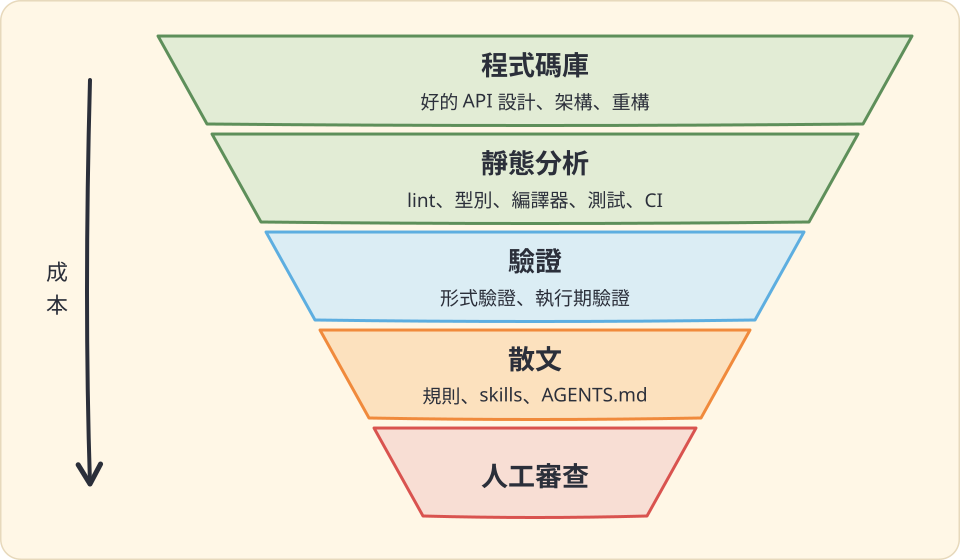
*圖：依講者投影片重繪的投入順序，成本箭頭朝向人工審查（〔畫面〕）。*

這座倒金字塔把程式碼庫放在最寬處，接著是靜態分析、驗證、自然語言規則，人工審查在尖端（[2:05](https://www.youtube.com/watch?v=O_zcc6Xl12g&t=125s)）。全文可帶著三個動作往下讀：先用架構封住常犯錯的路，再把糾正變成檢查，最後讓驗證產物承接審查〔推論〕。

## 產量放大之後，工程師仍得守住品質

影片第 1 章，0:00–2:03。Lauren 拿嫌棄別人程式碼是 slop 的心態開玩笑，隨即把題目拉回自己的工作。她回憶，以前公司會把極高產的工程師稱為 coding machine；她轉述 Bret Taylor 一個週末重寫 Google Maps 的軼事〔二手〕，用來襯托 agent 讓更多人有機會成為「寫程式機器」（[0:58](https://www.youtube.com/watch?v=O_zcc6Xl12g&t=58s)）。

產量門檻變了，工程師的責任還在。她的主張是「在大幅提升生產力的同時，找出如何維持甚至改善程式碼品質的方法」（[1:13](https://www.youtube.com/watch?v=O_zcc6Xl12g&t=73s)）。有人稱這種工作方式為 software factory，她則從信任談起：要投入時間改善 agent 的環境，才有理由相信它會做對。

這份信任有養成過程。她自述花了六個月〔講者〕，才走到能交付數千個 PR、其中許多在睡覺時完成的狀態（[1:40](https://www.youtube.com/watch?v=O_zcc6Xl12g&t=100s)）。她認為這條路走得通，聽眾也有機會少走些彎路；接下來的經驗，就是她為這份信任付出的工作。

## 信任要從程式碼庫養起，壞模式也會跟著長大

<!-- layout: stack -->

影片第 2 章，2:03–5:00。Lauren 把前兩層稱為確定性的約束：API、架構與重構決定能怎麼寫，lint、型別、編譯器與測試限制哪些寫法能留下。再疊上執行期與形式驗證，檢查系統屬性及 agent 是否理解意圖；需要判斷的部分，才交給 rules、skills、AGENTS.md（[2:09](https://www.youtube.com/watch?v=O_zcc6Xl12g&t=129s)）。

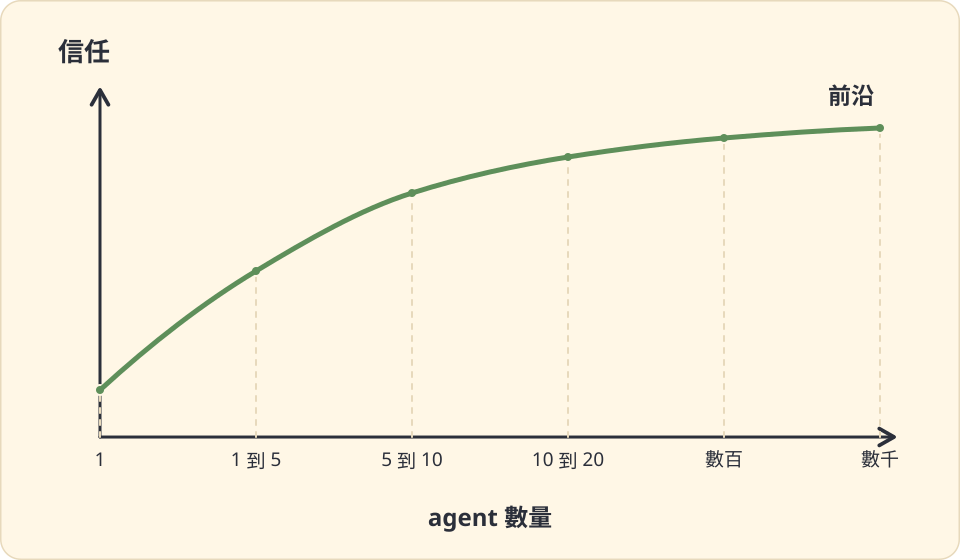
*圖：講者用來引入信任問題的示意曲線，沒有信任度測量值（〔畫面〕）。*

她回憶 2024 年上班時審同事的 3 個 PR，如今更像是 300 個〔講者〕。她用花園比喻程式碼庫：新程式碼長得愈快，架構與約束這些地基愈重要。投影片的「code is memory」點出原因：既有程式碼是 agent 最大的輸入來源之一，寫進程式碼的糾正，也更能重現。

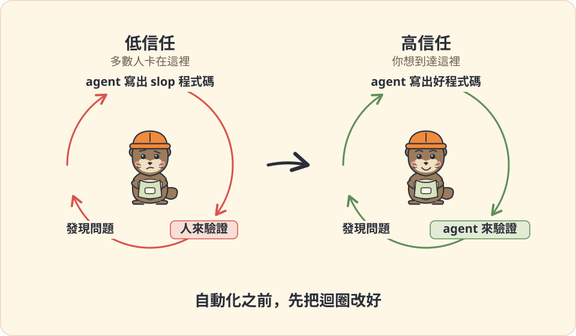
*圖：從人反覆驗證走向 agent 自行驗證，仍保留發現問題後回頭修改的迴圈（〔畫面〕）。*

壞模式也會被複製。她提醒，一個權宜之計留在庫裡，下一個 agent 就可能把它當成慣例；複製愈多，愈像理所當然（[4:26](https://www.youtube.com/watch?v=O_zcc6Xl12g&t=266s)）。她因此要求把程式碼庫整理乾淨，並在投影片提醒：有時仍該親自讀程式碼〔畫面〕。

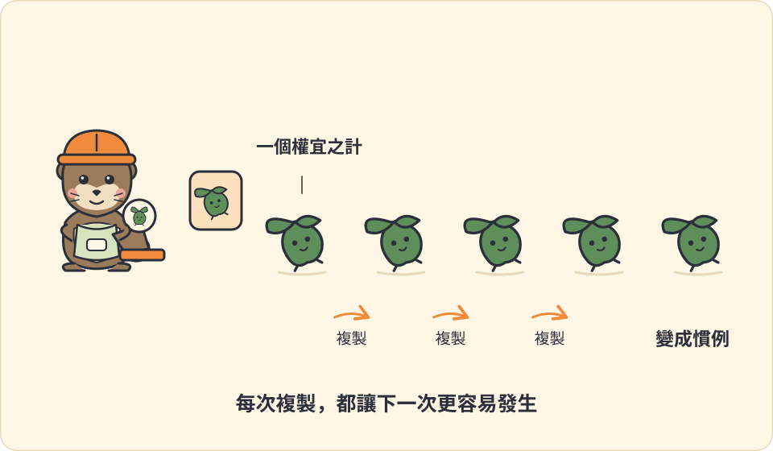
*圖：依投影片的複製效應重繪，蓋章與小苗為原創構圖（〔畫面〕）。*

## Dune 把容易走錯的路，直接擋在架構裡

影片第 3 章，5:00–6:56。Lauren 介紹團隊為 Grok Bot 建立的客戶端框架 Dune，形容它大概像 Electron 應用程式的 Next.js〔講者〕。她關心的是裡面編入了哪些教訓；投影片列出一個資料夾對應一個功能、嚴格禁止匯入、程式碼不留註解三項約束（[5:00](https://www.youtube.com/watch?v=O_zcc6Xl12g&t=300s)）。

useEffect 是她的例子。她承認它有適用情境，但用好需要細微判斷，agent 又常誤用。因此她的團隊禁止產品程式碼使用 useEffect，只在 Dune API 內部少數地方開放。依她的經驗，這讓審查時不必再反覆抓同一類問題（[5:52](https://www.youtube.com/watch?v=O_zcc6Xl12g&t=352s)）。

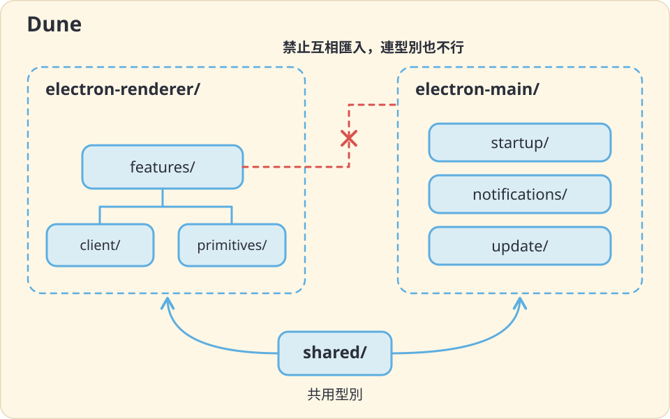
*圖：以目錄結構與匯入禁令建立邊界（〔畫面〕）。*

她說他們在 Cursor 上看到，這個 Electron 應用程式裡，agent 常把 main 程式碼 import 進 renderer，造成長任務與卡頓〔講者〕。她的團隊於是在 Grok Bot／Dune 用明確命名的目錄提供脈絡，再由相依圖分析器和 lint 規則禁止互相匯入（[6:15](https://www.youtube.com/watch?v=O_zcc6Xl12g&t=375s)）。投影片連型別都劃進禁令；邊界一旦能強制執行，就少一件需要人記住的審查工作。

## 把註解換成會擋錯的規則，糾正才會留下來

<!-- layout: stack -->

影片第 4 章，6:56–9:40。Lauren 觀察到，agent 會把 Markdown 文件、註解、rules 和 skills 當成替捷徑辯解的地方，也可能把一次小修正誇大成永久禁令。寫得愈多，不一定愈可靠。

她說他們在 Cursor 上看到的計時器問題很具體：agent 用 setTimeout、requestAnimationFrame、requestIdleCallback 快速修補，掩蓋 VS Code 命令式風格與 React 宣告式風格的衝突。她指出，大量計時器反覆建立、銷毀造成垃圾回收與卡頓；註解又替這些寫法辯護，讓問題繼續蔓延（[7:24](https://www.youtube.com/watch?v=O_zcc6Xl12g&t=444s)）。

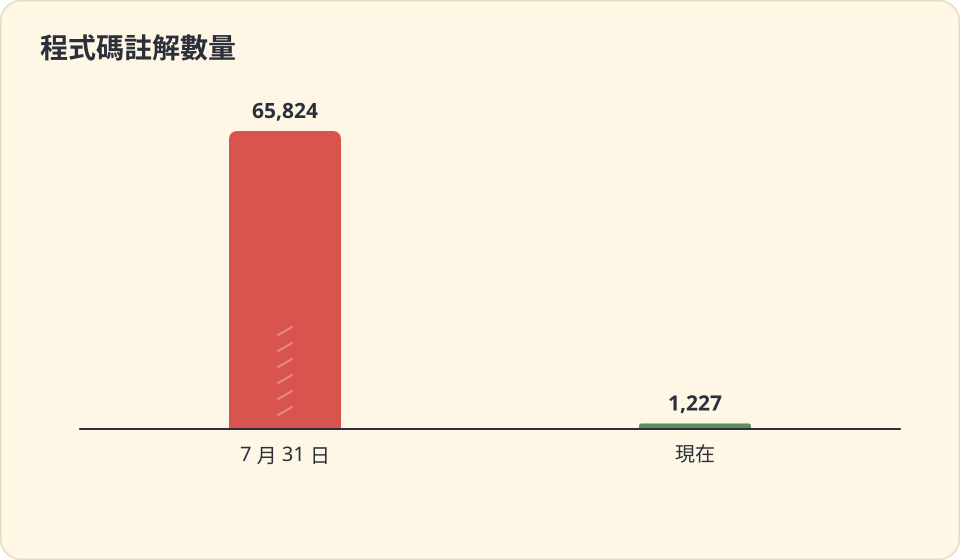
*圖：講者展示的註解數量前後對照（〔畫面〕）。*

她的團隊在 Grok Bot 決定禁用 99% 的註解〔講者〕，投影片呈現 65,824→1,227〔畫面〕。她最在意的是註解無法強制執行；團隊改用 lint 規則，錯誤訊息還要指向根因，要求 agent 修真正的問題（[8:22](https://www.youtube.com/watch?v=O_zcc6Xl12g&t=502s)）。

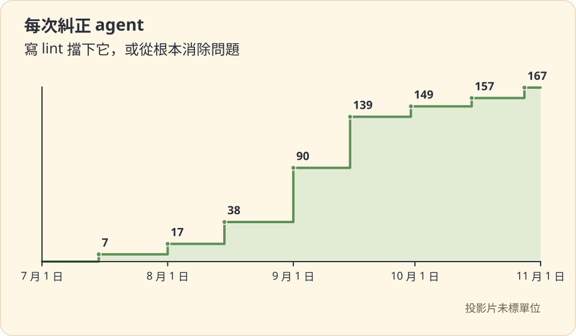
*圖：依講者脈絡，可將階梯理解為糾正逐步累積成檢查；確切計數單位未標示（〔推論〕）。*

她把原則推到審查工作上：糾正變成確定性檢查，或由 API 與架構消除整類問題，需要留意的事情就會減少。她描繪的終點，是某天發現已沒什麼需要再審，能讓 agent 自行合併大部分 PR（[9:30](https://www.youtube.com/watch?v=O_zcc6Xl12g&t=570s)）。

## 讓 agent 實際操作程式，審查就有成果可看

影片第 5 章，9:40–10:50。Lauren 接著交代審查怎麼縮小：她的團隊主要改看驗證產物，包括影片、截圖、圖表與形式驗證（[9:50](https://www.youtube.com/watch?v=O_zcc6Xl12g&t=590s)）。人仍要判斷成果，只是眼前多了程式實際運作的證據。

執行期驗證在她的說明裡很直接：讓 agent 自己跑程式，也能使用 Chrome DevTools Protocol 等開發者的除錯工具。能操作還不夠，它得知道要去哪裡。團隊因此在 skill 裡放入功能地圖，從使用者角度列出有哪些功能，以及如何到達。

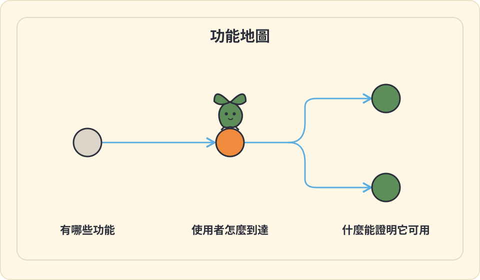
*圖：功能地圖把使用者描述與可驗證的操作連起來（〔畫面〕）。*

這張地圖提供共通詞彙。當人提到「左側邊欄的那個小東西」，agent 就比較不必瞎猜指的是哪裡（[10:29](https://www.youtube.com/watch?v=O_zcc6Xl12g&t=629s)）。她的團隊還把自製 CLI 與 driver 放進 skills，讓操作方式能重複使用；她認為這既減少 token 消耗，也讓工具本身可以測試。從找功能到留下驗證產物，agent 因而有一條可反覆走的路。

## 形式驗證讓狀態與演算法多一層檢查

影片第 6 章，10:50–11:51。Lauren 介紹團隊近期的實驗：用 TLA+ 對主要使用者流程做模型檢查，例如跨裝置、跨平台的通知；另用 Lean 證明特定演算法，例子是自製虛擬化函式庫中的畫面閃爍與抖動問題（[10:54](https://www.youtube.com/watch?v=O_zcc6Xl12g&t=654s)）。

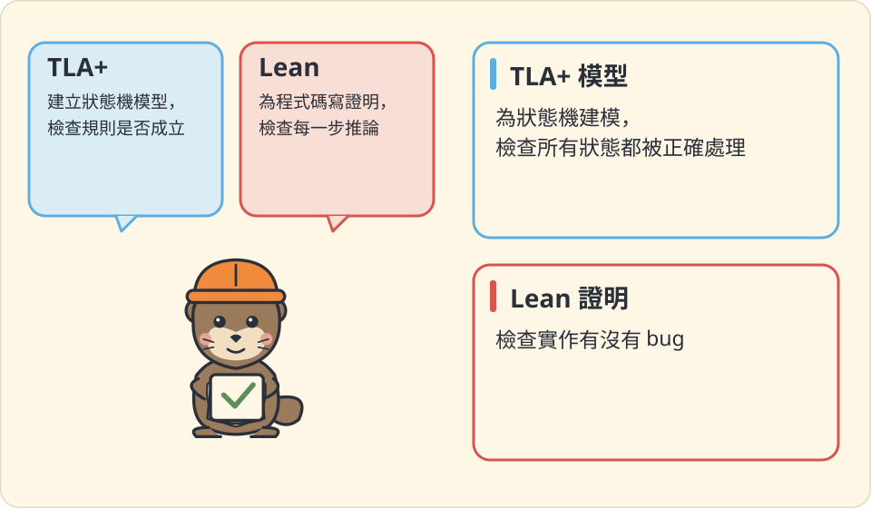
*圖：依投影片重繪的 TLA+ 與 Lean 分工（〔畫面〕）。*

她沒有把這套方法說成已經完成的答案。團隊仍在實驗，雖然已抓到不少 bug，她也明說它不是萬靈丹，只是 agent 環境中再疊上一層工具（[11:16](https://www.youtube.com/watch?v=O_zcc6Xl12g&t=676s)）。

UI 也有另一條檢查路徑。她展示團隊剛開始使用 Bombadil〔一手〕做屬性測試，並表示已找到幾個 UI bug（[11:43](https://www.youtube.com/watch?v=O_zcc6Xl12g&t=703s)）。這裡的重點仍是增加驗證方式：程式跑得動之外，還要能檢查狀態轉換與實作是否符合預期。

## token 大多花在驗證，才有條件相信產生的程式碼

影片第 7 章，11:51–13:32。Lauren 引用 Cindy Sridharan 的兩則推文：2026-05-15 那則談到帶著細微 bug 的 AI PR 被合併，後續得花力氣人工修補；到了後一則，重點轉為補齊驗證流程〔畫面〕。

> 70% of my daily token spend goes into verifying patches, and only ~20-30% into creating them.
>
> （Cindy Sridharan @copyconstruct，投影片顯示的 2026-11-05 推文；X 頁面本機抓不到，只憑投影片〔畫面〕）

也就是每天約七成 token 用在驗證修補，只有約兩至三成用在產生。Lauren 認為這符合自己的觀察：她大部分 token 也花在驗證上（[12:15](https://www.youtube.com/watch?v=O_zcc6Xl12g&t=735s)）。

她接著指出，這些技術過去就存在，只是理解、撰寫與維護的成本可能高到難以採用。agent 降低了成本，讓更深入的測試變得划算；她因此認為軟體測試與驗證正在進入黃金時代（[12:30](https://www.youtube.com/watch?v=O_zcc6Xl12g&t=750s)）。

驗證也能用來確認產品意圖。她介紹 pstack 裡的 statechart skill〔一手〕，把使用者眼中的狀態機畫出來，搭配影片與截圖，讓審查更容易（[13:02](https://www.youtube.com/watch?v=O_zcc6Xl12g&t=782s)）。在她的工作裡，驗證產物開始成為理解變更的入口。

## PR 增加時，她也把發布節奏與還原率攤開來看

<!-- layout: stack -->

影片第 8 章，13:32–15:11。Lauren 展示團隊投入之後的成果：10 月合併 10,926 個 PR，6–10 月合計 23,370〔畫面〕；她以約 11,000 個 PR 描述上月交付量（[13:37](https://www.youtube.com/watch?v=O_zcc6Xl12g&t=817s)）。個人曲線與團隊曲線放在一起，呈現她所說的產量變化。

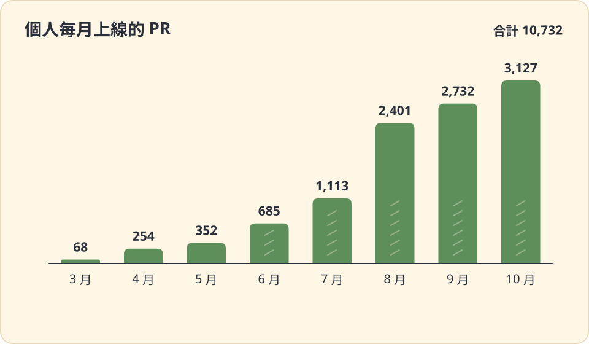
*圖：講者個人上線 PR 的月份分布（〔畫面〕）。*

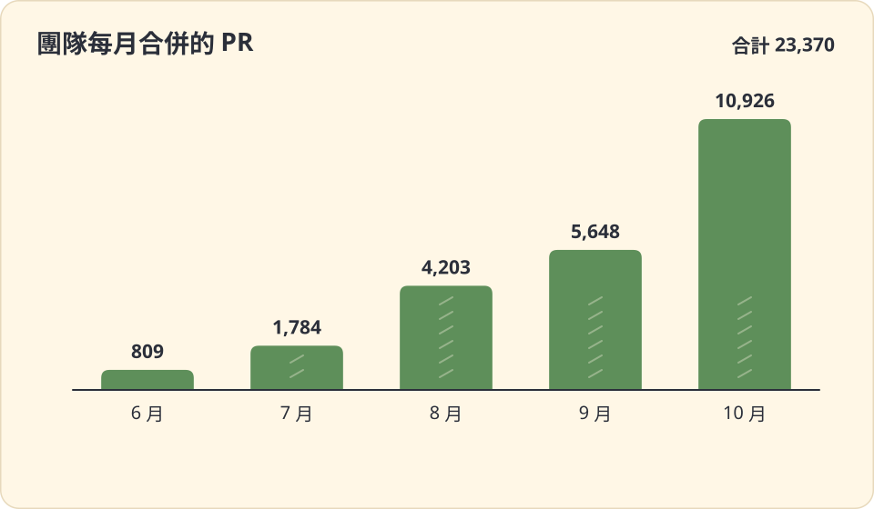
*圖：團隊圖表的統計名稱為合併 PR（〔畫面〕）。*

客戶端發布也跟著加快：8、9、10 月分別發布 7、19、15 次〔畫面〕。她形容大約每天有一個穩定版，並提到 10 月約有 227 人至少貢獻一個 PR〔講者〕；其中包括未必掌握很多背景的臨時貢獻者。

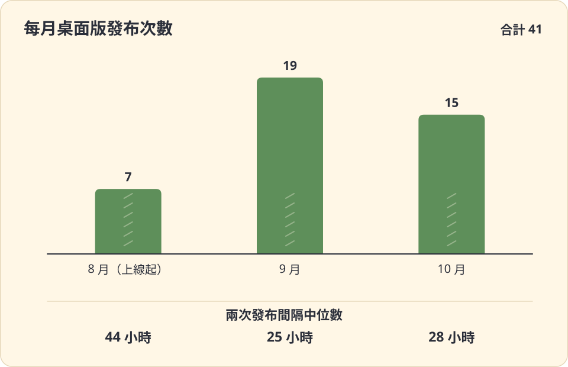
*圖：每月發布次數及兩次發布的中位間隔（〔畫面〕）。*

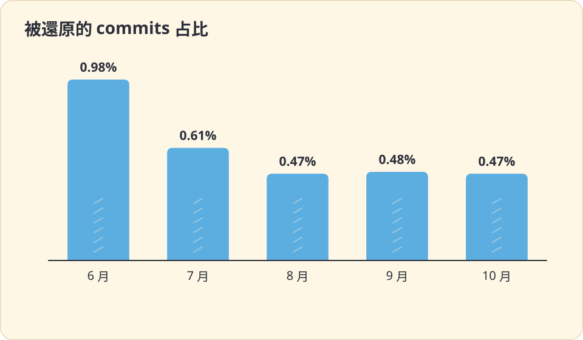
*圖：投影片以 commits 為單位呈現還原率（〔畫面〕）。*

她用還原率回應「這難道不會變成一堆 slop 嗎？」的疑問，形容比例穩定在約 0.5%〔講者〕（[14:21](https://www.youtube.com/watch?v=O_zcc6Xl12g&t=861s)）。她接著談效能：相較剛推出時，啟動、輸入、開新對話與切換對話都變快了；對一個交付速度這麼高、參與人數這麼多的 Electron 應用程式，她認為這樣的表現「相當不錯」。

## 先讓內圈可靠，再替它接上自動觸發

影片第 9 章，15:11–17:31。Lauren 收尾時把順序講得很清楚：下次糾正 agent，先改善程式碼庫；建立 lint 規則擋住新反模式，再清掉舊模式，接著把驗證做扎實（[15:11](https://www.youtube.com/watch?v=O_zcc6Xl12g&t=911s)）。這些投入是她走向自動化的先決條件。

她警告，內圈寫程式的迴圈如果一直產出 slop，自動化只會放大產量，還得投入更多 token 收拾。前面低信任與高信任的差別，到這裡成了能否擴大運作的條件：先把寫程式、驗證、修正這個循環做好，才有基礎接上外圈。

她以 Grok Bot 說明外圈的角色：啟動 Cursor 專案與雲端 agent，編排後續工作。依她的團隊經驗，每次發布新版本，Grok Bot 就啟動 Cursor 專案，實際操作整個應用程式做模糊測試；找到 bug 後開修復 PR，再自動合併〔講者〕（[16:21](https://www.youtube.com/watch?v=O_zcc6Xl12g&t=981s)）。

她把這種做法歸因於程式碼庫已整理到 PR 往往預設就有好品質，大多數產品程式碼不再需要深入的人工審查（[16:44](https://www.youtube.com/watch?v=O_zcc6Xl12g&t=1004s)）。

## 數字背後：統計口徑與公開佐證決定能讀到哪裡

<!-- layout: stack -->

| 要核對的事 | 帳本記錄與閱讀界線 |
|---|---|
| 成果從哪裡來 | PR、發布、註解、效能與還原率均來自講者簡報，沒有獨立第二來源〔畫面〕。 |
| PR 與還原率的單位 | 團隊圖寫 merged，口述為 shipped to production；還原率圖的單位是 commits，口述卻說 PR，兩組用語不能直接視為相同〔畫面〕〔講者〕。 |
| 約每天一個穩定版 | 口述是近似描述；圖上 9、10 月的兩次發布中位間隔為 25、28 小時，並非保證每天發布〔畫面〕。 |
| 效能也有退步 | 記憶體 +12%、閒置 CPU +100%、啟動 js+css +285%、視窗縮放耗時 +130%，冷開長聊天也增加 8%〔畫面〕。 |
| 哪些工具可公開核對 | Dune 與 Grok Bot 使用 Electron 尚無公開佐證，僅有講者自述；pstack 與 Bombadil 則有可查的原始 repo〔一手〕。 |
| 禁令留下哪些取捨 | 禁 99% 註解與禁 useEffect 是她的團隊選擇；講者未談代價，不能直接當成所有專案的通則〔推論〕。 |

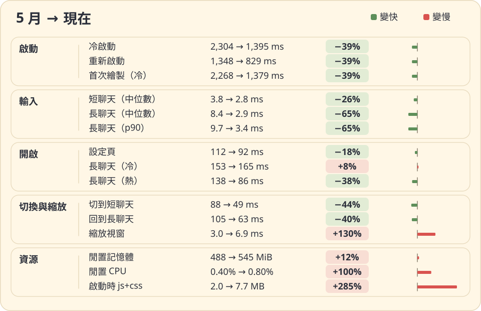
*圖：依投影片重繪效能全表；講者底註承認有天花板，並表示正考慮 Rust 重寫的想法（〔畫面〕）。*

身分資料也有不同寫法：影片版面標 Principal Engineer／SpaceX；poteto 的 GitHub 檔案則寫 Software Engineer、任職 @xai-org，另列 React compiler core team〔一手〕。本文開場採影片標示。Grok Bot 官方頁可確認產品已離開 beta〔一手〕；帳本所記 beta 2026-08-11、1.0 2026-11-11 則屬二手時程。Bret Taylor 軼事也僅有他人轉述，兩者都未見官方原文〔二手〕。

## 可以帶走的做法：下次糾正時，多留下一道檢查

以下三步是本文依講者經驗整理的實作起點〔推論〕。

1. 先問這個錯誤能在哪一層擋住。遇到錯誤匯入，就檢查目錄與相依邊界；遇到容易誤用的 API，就檢查能否收斂入口。先找程式碼裡能承接糾正的位置，再判斷是否還需要自然語言規則〔推論〕。
2. 把常被糾正的模式變成 lint 規則，連錯誤訊息一起設計。訊息要能把 agent 帶回根因，並清理庫裡既有的壞範例，免得下一輪又照抄；只擋新寫法，舊模式仍可能持續提供錯誤示範〔推論〕。
3. 審 diff 前先看驗證產物。要求能對應使用者流程的影片、截圖或狀態圖，確認 agent 實際走過哪條路、留下什麼證據；若產物還看不出它是否理解需求，就把缺的那一段補進驗證流程〔推論〕。

不用從她的 PR 數量起跑。挑一個你已經糾正過多次的問題，讓下一個 agent 再走到那裡時，真的遇得到一道檢查〔推論〕。

## 製作說明：這篇導讀由 AI 模型完成

規劃與審稿由 Claude Opus 負責，主文與圖表由 Codex（gpt-6-astra）依企劃與證據帳本製作。本文沒有經過人工逐句校稿。

agy（gemini-3.8-flash）分 9 段觀看影片，校正字幕並盤點投影片。中文字幕由 agy 翻譯，再由 Opus 逐句閱讀；poteto、Grok Bot、Dune、TLA+ 等機器字幕的誤聽已更正。事實查證用 GitHub API、官方頁與網路搜尋，結果記在證據帳本；agy 的描述只當線索；用在圖表的數字與文字，Opus 另用影格逐張核對（未逐張核對全部投影片）。

本文圖表是依投影片資訊重繪的 SVG，並非講者原圖；封面與插圖為 AI 生成，角色為原創，視覺風格受講者簡報啟發。講者簡報與影片版權屬原權利人。

可搭配[全文繁中譯文](translation-zh.html)與[雙語字幕播放器](player.html)閱讀，並由各段時間連結回到原片。

## 來源清單

### 一手

- [pstack repo](https://github.com/cursor/plugins/tree/main/pstack)：確認 statechart、no-comments、create-formal-verification-skill 三個 skill 存在。
- [Bombadil repo](https://github.com/antithesishq/bombadil)：網頁與終端機 UI 的屬性測試工具。
- [Grok Bot 官方產品頁](https://x.ai/bot)：頁面標示已離開 beta。
- [poteto 的 GitHub 個人檔案](https://github.com/poteto)：講者自填身分與任職；帳本查證日期為 2026-11-15。

### 影片

- [All Code Is Slop (Except Mine) — Lauren Tan](https://www.youtube.com/watch?v=O_zcc6Xl12g)：AI Engineer 頻道，2026-11-14 上傳。

### 畫面

- 同一影片的投影片：倒金字塔、架構與驗證示意、成果圖表、Cindy Sridharan 引句。重繪圖與口述時間連結保留在相關場內。

### 二手（未見官方原文）

- [AI Weekly：SpaceXAI and Cursor ship Grok Bot beta on Mac, iOS, PC, Linux](https://aiweekly.co/alerts/spacexai-and-cursor-ship-grok-bot-beta-on-mac-ios-pc-linux)：標示發表於 2026-08-11（beta 開始）；媒體彙整稿，未見官方原文。
- [WebProNews：Grok Bot 1.0 離開 beta](https://www.webpronews.com/grok-bot-1-0-shared-teammates-teams-meetings/)：2026-11-11 離開 beta 的說法；本機抓取回 403，只看過搜尋摘要，未實讀。
- [Grapevine：Paul Buchheit 談 Bret Taylor 一個週末重寫 Google Maps](https://grapevine.in/post/Gmail-creator-Paul-Buchheit-on-how-Bret-Taylor-once-rewrote-Google-Maps-in-a-single-weekend-620aaab4-62d3-48ac-ba79-e6309cc6865a)：本機抓取回 429，只看過搜尋摘要，未實讀；沒有 Bret Taylor 本人的說法，只當 Lauren 轉述的軼事。
